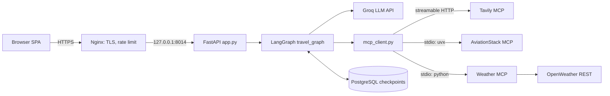
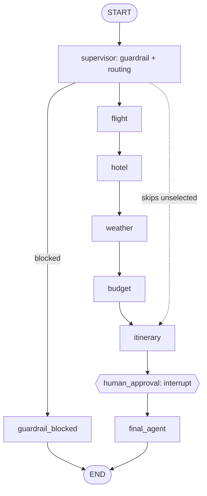
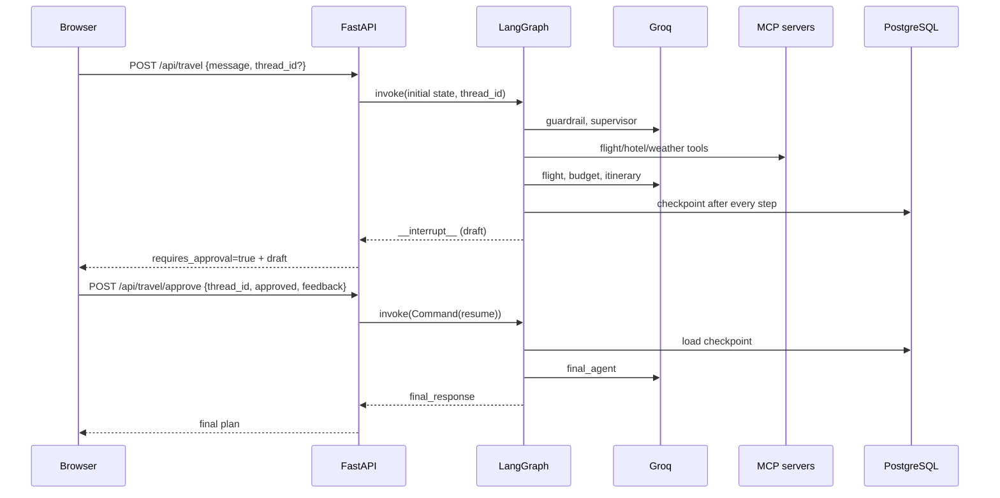

# 02 - Architecture

> **Status:** this document is the **baseline audit** of the code before remediation. Most findings referenced here are now fixed; see [13_REMEDIATION_REPORT.md](13_REMEDIATION_REPORT.md) for the current status and evidence.

## System context

## Graph

Agents execute strictly in `AGENT_ORDER` (`backend.py:109`); the supervisor
only decides which are skipped. `itinerary_agent` is always appended.

## Request sequence (draft then approval)

## Layers

- **Frontend:** static page; state in three JS globals and one
  `localStorage` key. No framework, no build step.
- **API:** two POST endpoints plus health. Pydantic validation only.
- **Orchestration:** one compiled graph with a Postgres checkpointer.
- **Tools:** MCP servers, each loaded independently so one failure degrades
  only the agent that needs it.
- **Cross-cutting:** token budgeting (`llm_utils.py`), `print` logging,
  fail-open guardrail/supervisor, per-agent degradation messages.

## Notable design traits

1. Sync agent functions bridge to async MCP via `asyncio.run` +
   `nest_asyncio` (`app.py:15-17`).
2. Routes are `async def` but call synchronous `graph.invoke` (see F-12).
3. One module-level psycopg connection is shared by the whole process (F-13).
4. Not present: RAG, vector DB, long-term memory, background jobs, file
   storage, auth, caching.
