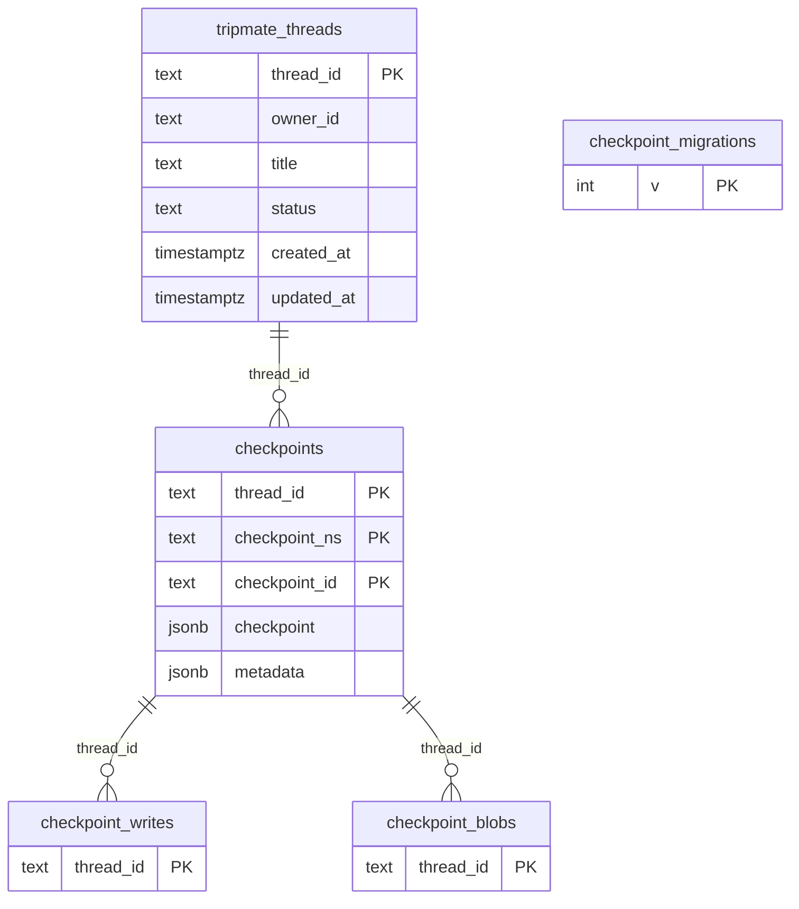

# 05 - Database (updated after remediation)

- Technology: PostgreSQL (17-alpine locally; host install in production).
- Access: `psycopg_pool.ConnectionPool` (max 10 by default, `check_connection`
  on checkout, `autocommit=True`, `prepare_threshold=0`, `dict_row`), opened in
  the FastAPI lifespan.
- LangGraph tables are created by `PostgresSaver.setup()` (names/keys verified
  against langgraph-checkpoint-postgres 3.1.0 and against a live database).
- The app adds one table, `tripmate_threads`, via `CREATE TABLE IF NOT EXISTS`
  at startup (`store.py`).

Indexes added: `(owner_id, updated_at DESC)` and `(updated_at)`. No declared
foreign keys; links are logical through `thread_id`.

## Lifecycle

| Operation | When |
|---|---|
| Create | `start_trip` inserts a `tripmate_threads` row; every graph step writes checkpoints |
| Read | Ownership check on every trip call; resume/restore read the latest checkpoint |
| Update | Status (`running`, `awaiting_approval`, `completed`, `blocked`, `failed`) and `updated_at` after each run; checkpoints are append-only |
| Delete | `DELETE /api/travel/{id}` removes checkpoints (`delete_thread`) and the row; the retention loop does the same for trips untouched for `RETENTION_DAYS` (default 30), every 6 hours |

Backups: `deploy/deploy.sh` takes a gzip `pg_dump` before each deploy (last 7 kept).
