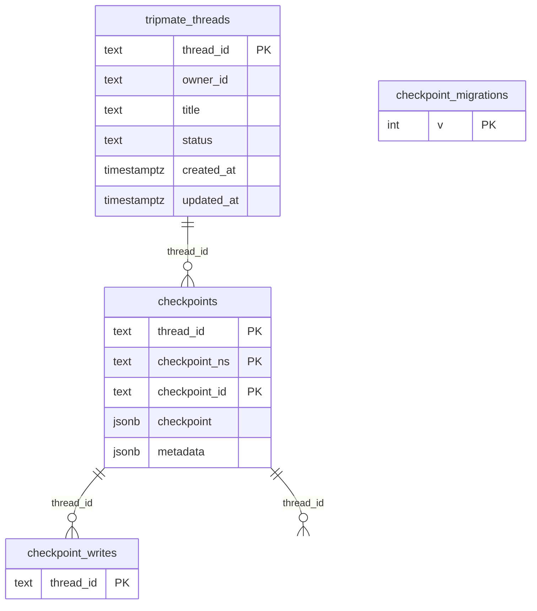
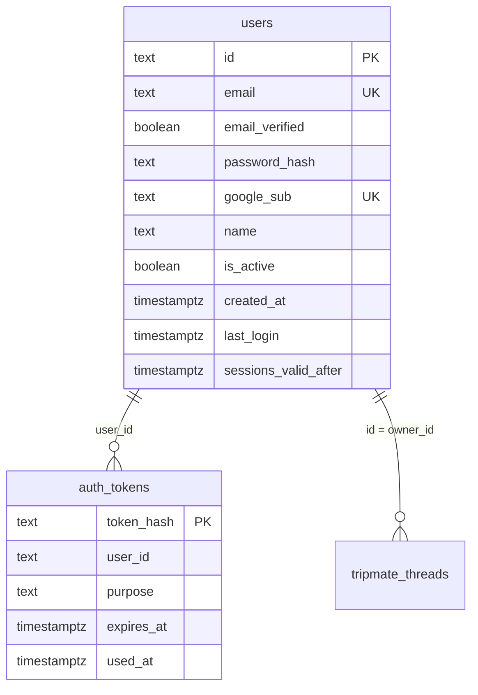

# 05 - Database (updated after remediation)

- Technology: PostgreSQL (17-alpine locally; host install in production).
- Access: `psycopg_pool.ConnectionPool` (max 10 by default, `check_connection`
  on checkout, `autocommit=True`, `prepare_threshold=0`, `dict_row`), opened in
  the FastAPI lifespan.
- LangGraph tables are created by `PostgresSaver.setup()` (names/keys verified
  against langgraph-checkpoint-postgres 3.1.0 and against a live database).
- The app adds one table, `tripmate_threads`, via `CREATE TABLE IF NOT EXISTS`
  at startup (`store.py`).

Indexes added: `(owner_id, updated_at DESC)` and `(updated_at)`. No declared
foreign keys; links are logical through `thread_id`.

## Lifecycle

| Operation | When |
|---|---|
| Create | `start_trip` inserts a `tripmate_threads` row; every graph step writes checkpoints |
| Read | Ownership check on every trip call; resume/restore read the latest checkpoint |
| Update | Status (`running`, `awaiting_approval`, `completed`, `blocked`, `failed`) and `updated_at` after each run; checkpoints are append-only |
| Delete | `DELETE /api/travel/{id}` removes checkpoints (`delete_thread`) and the row; the retention loop does the same for trips untouched for `RETENTION_DAYS` (default 30), every 6 hours |

Backups: `deploy/deploy.sh` takes a gzip `pg_dump` before each deploy (last 7 kept).

## Accounts (added with user registration)

Two tables, created with `CREATE TABLE IF NOT EXISTS` at startup (one statement per call):

- `password_hash` is scrypt (`scrypt$n$r$p$salt$hash`) and is NULL for Google-only users; it is never returned by the store's normal read.
- `auth_tokens` holds only a SHA-256 of each emailed token (purposes `verify`, `reset`); consumption is a single atomic `UPDATE ... WHERE used_at IS NULL AND expires_at > now() RETURNING user_id`, so a link works once.
- `sessions_valid_after` is written from the **application** clock (not `now()`), because session tokens carry the application's issue time; a password reset raises it, which signs out all older sessions.
- `tripmate_threads.owner_id` is now the user id, so trips follow the person across devices. Account deletion removes the user's trips and checkpoints, their tokens, and the user row.

## v2.2 tables

- `users.role TEXT NOT NULL DEFAULT 'user'` (added with `ALTER TABLE ... ADD COLUMN IF NOT EXISTS`).
- `api_request_logs(id, ts, request_id, method, path, status, duration_ms, user_id, ip)`, index on `ts`; written in batches by a background thread; purged after `LOG_RETENTION_DAYS`.
- Token accounting: `api_request_logs.input_tokens/output_tokens/llm_calls` and `tripmate_threads.input_tokens/output_tokens/llm_calls` (all added with `ADD COLUMN IF NOT EXISTS`, verified on an existing database).
- `admin_audit_log(id, ts, actor_id, actor_email, action, target, detail, ip)`.
- SQL statement log: not a table. A psycopg cursor subclass (`observability.make_cursor_class`, set as the pool's `cursor_factory`) times each statement; only text and timing are kept, in a 2000-entry in-memory ring. Statements touching the two log tables are not recorded.
